# AI BenchMate

**Your Smart Student Companion**

AI BenchMate is a Flutter-based student productivity application designed to bring AI-powered learning assistance, document management, assignment tracking, and personal finance management into one place.

## Features

### 1. AI Mate
- AI-powered question answering and learning assistance
- Context-aware conversations
- Create new chats
- View previous chat history
- Firebase Authentication and Firestore-based chat history

### 2. Document Vault
- Import and manage personal documents
- Support for PDF, JPG, JPEG, and PNG
- Organize documents by category
- Search and filter documents
- Preview, rename, share, and delete documents
- Local document storage

### 3. Assignments
- Create and manage assignments
- Add subject, description, due date, and priority
- Track pending and completed assignments
- Filter assignments by status
- Mark assignments as completed or delete them

### 4. Expense & Fees Tracker
- Track income and expenses
- Maintain separate cash and bank balances
- Record transactions by payment source
- Option to update available balances
- Manage student fees
- Track paid and unpaid fees

## Technology Stack

| Category | Technologies |
|---|---|
| Mobile Development | Flutter, Dart |
| State Management | GetX |
| Authentication | Firebase Authentication |
| Cloud Database | Cloud Firestore |
| Local Storage | GetStorage |
| Document Storage | Path Provider |
| File Selection | Android Native File Picker |
| PDF Preview | pdfx |
| Backend | Python, FastAPI |
| AI Integration | Groq API |
| API Communication | REST API |
| Development Tools | VS Code, Android Studio, Git, GitHub |

## Application Screenshots

### Authentication and Home

| Entry Screen | Sign Up |
|---|---|
| 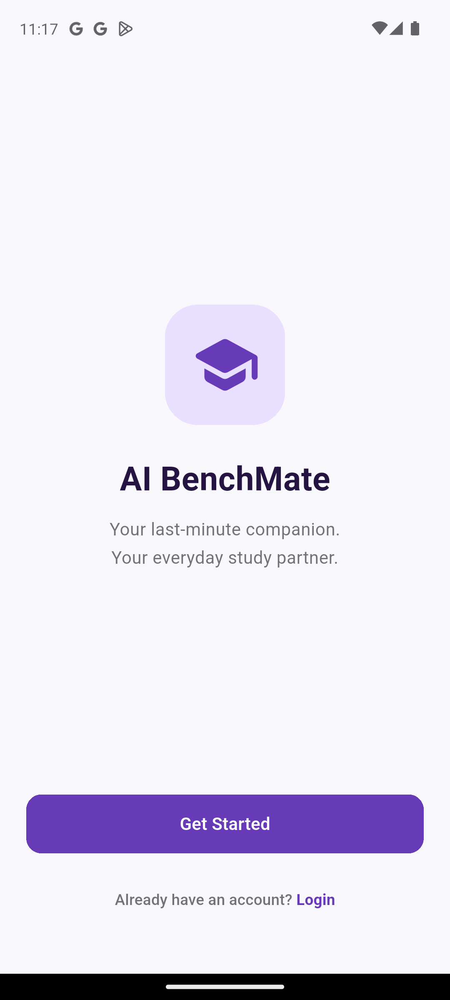 | 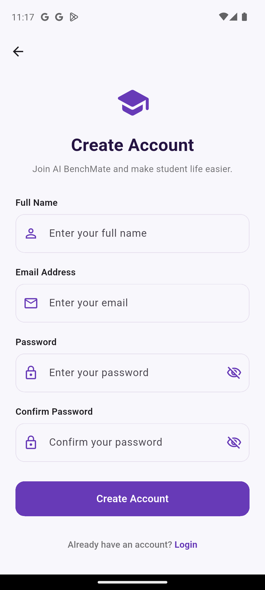 |

| Login | Home Dashboard |
|---|---|
| 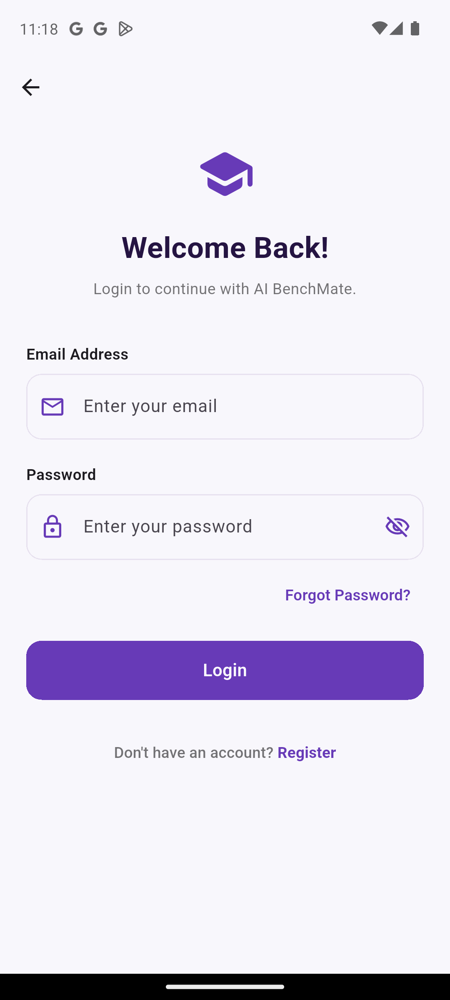 | 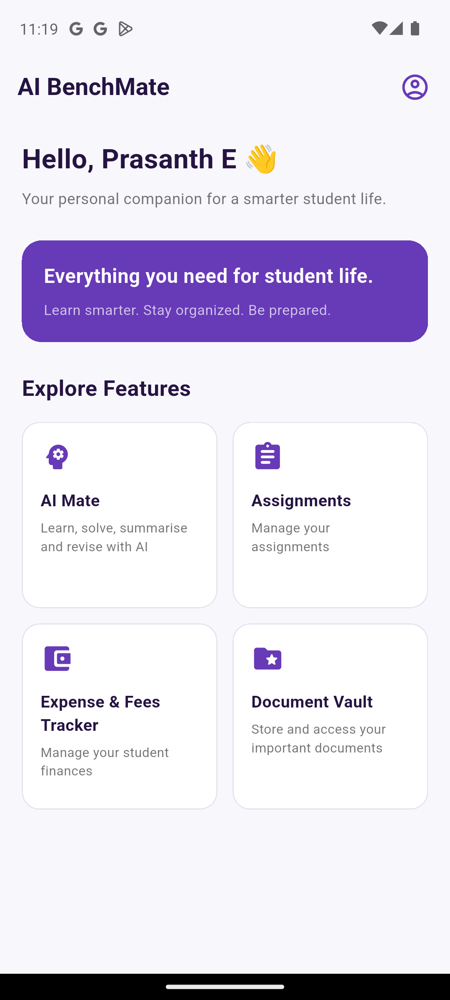 |

### AI Mate

| AI Chat | New Chat |
|---|---|
| 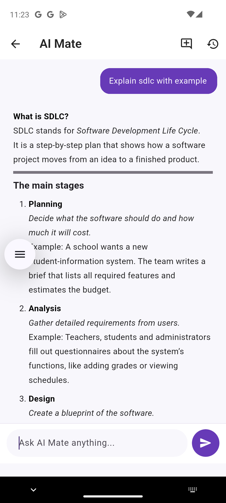 | 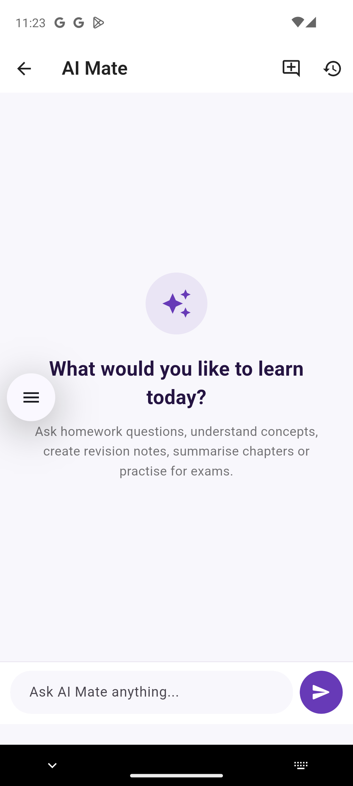 |

| Chat History |
|---|
| 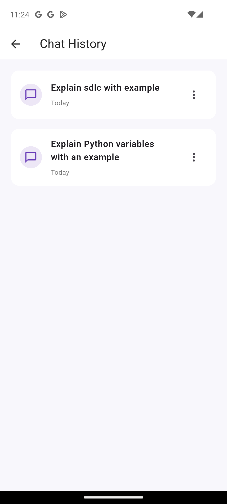 |

### Assignments

| Assignment List | Add Assignment |
|---|---|
| 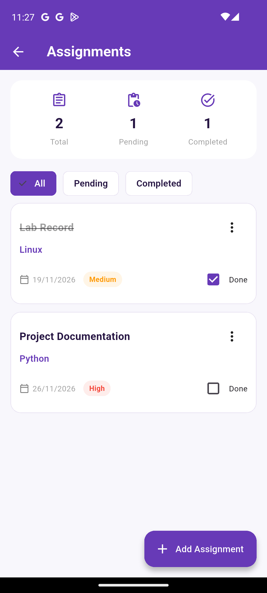 | 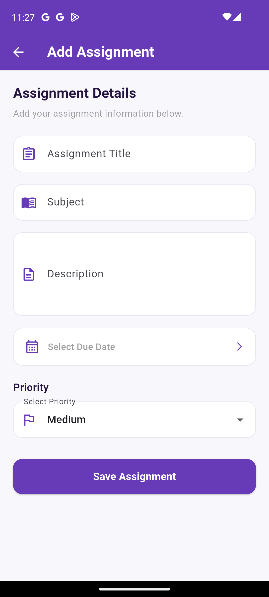 |

### Expense & Fees Tracker

| Expense Dashboard | Add Transaction |
|---|---|
| 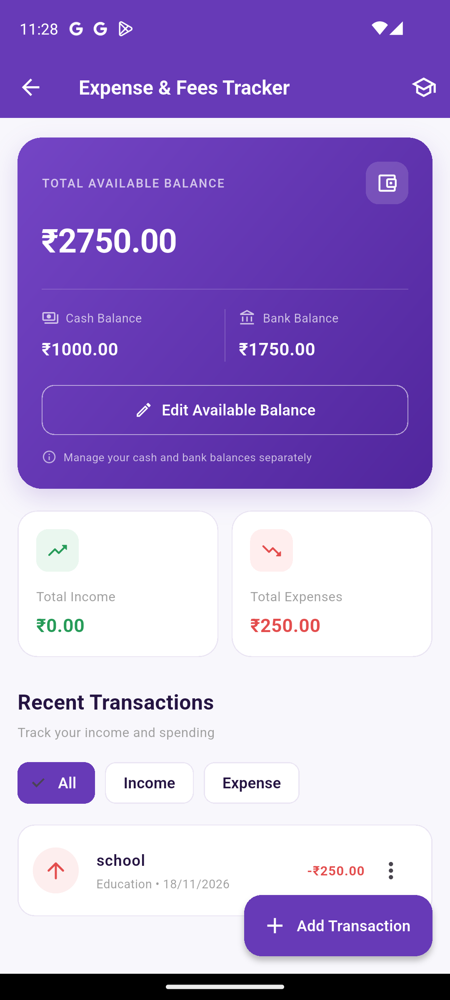 | 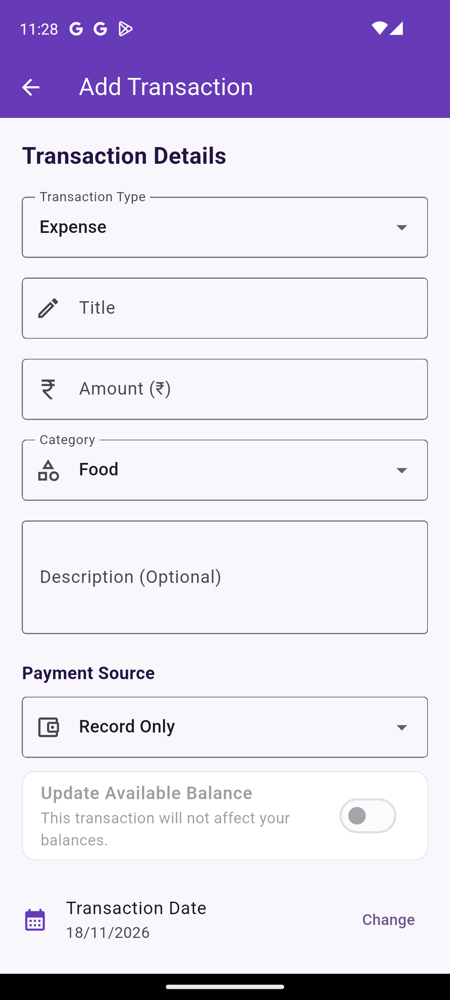 |

| Fees |
|---|
| 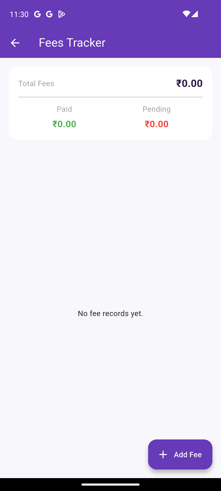 |

### Document Vault

| Document Vault | Import Document |
|---|---|
| 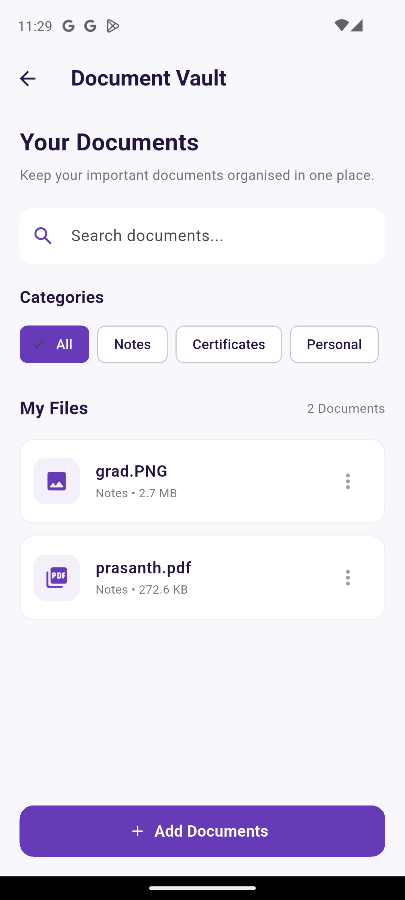 | 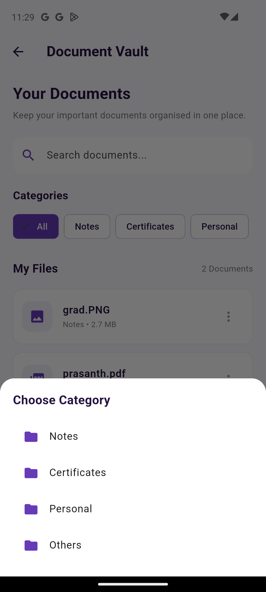 |

| Document Preview |
|---|
| 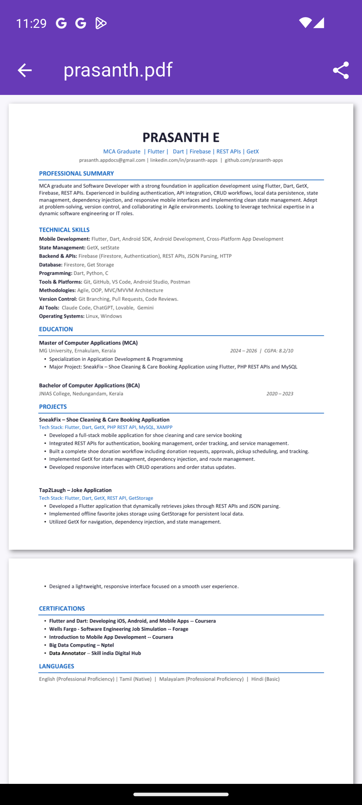 |

## Getting Started

### Prerequisites
- Flutter SDK
- Dart SDK
- Android Studio or VS Code
- Firebase project
- Python environment for the AI backend

### Installation

1. Clone the repository:

   ```bash
   git clone https://github.com/prasanth-apps/ai-benchmate.git
   ```

2. Navigate to the project:

   ```bash
   cd ai-benchmate
   ```

3. Install dependencies:

   ```bash
   flutter pub get
   ```

4. Configure Firebase for your Android application using your Firebase project configuration.

5. Run the application:

   ```bash
   flutter run
   ```

### AI Backend

The AI Mate backend is deployed at:

`https://ai-benchmate.onrender.com`

The backend uses FastAPI and Groq for AI responses. API credentials are maintained on the backend and should not be embedded in the Flutter application.

## Release APK

The Android release APK is generated using:

```bash
flutter build apk --release
```

Output:

`build/app/outputs/flutter-apk/app-release.apk`

## Storage and Architecture

- AI Mate: Firebase Authentication and Cloud Firestore, with AI responses served through the FastAPI backend.
- Document Vault: Documents stored locally on the device; document metadata stored using GetStorage.
- Assignments: Local persistence using GetStorage.
- Expense & Fees Tracker: Local persistence using GetStorage.

## Future Improvements

- Cloud backup and synchronization for local modules
- Additional student productivity tools
- Enhanced analytics and reporting
- Further UI and accessibility improvements

## Developer

**Prasanth E**

MCA Graduate | Flutter & Mobile Application Development

GitHub: https://github.com/prasanth-apps

---

*AI BenchMate — One app for smarter student productivity.*
